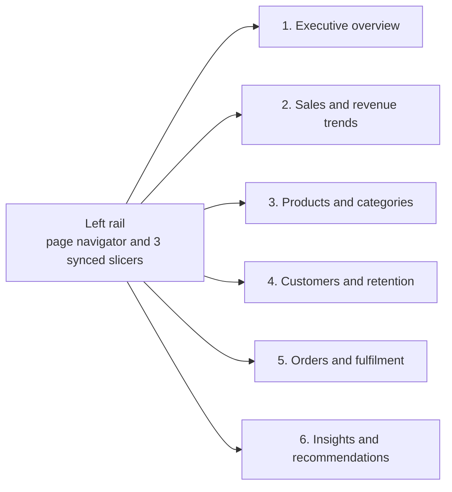
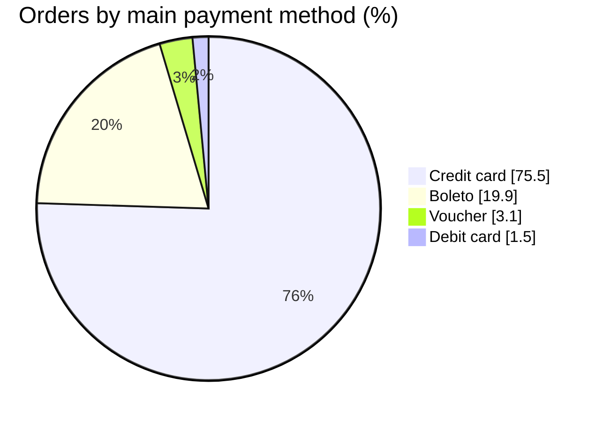
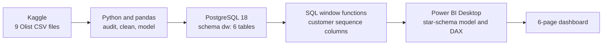
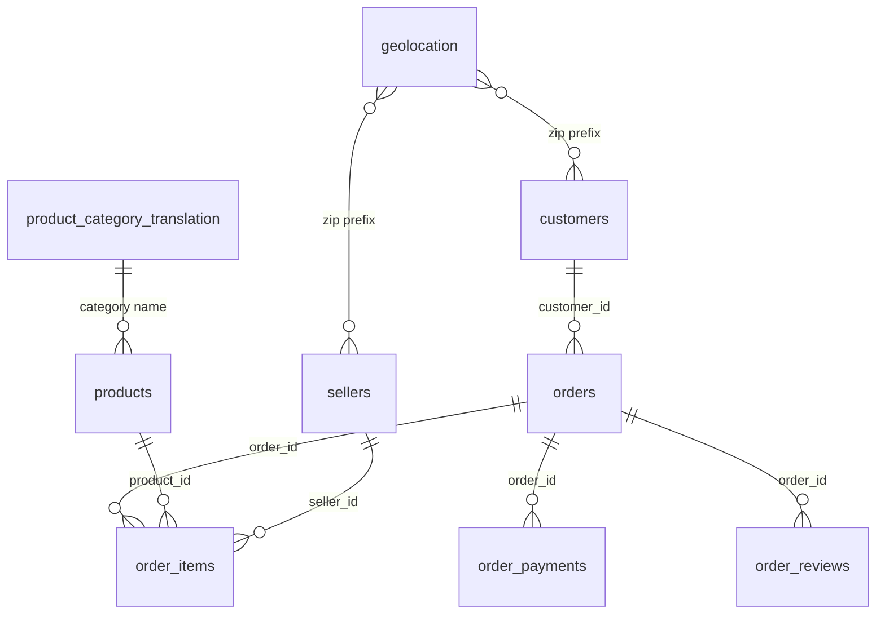
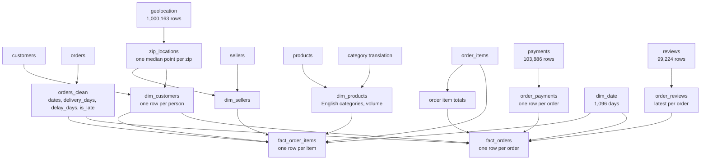
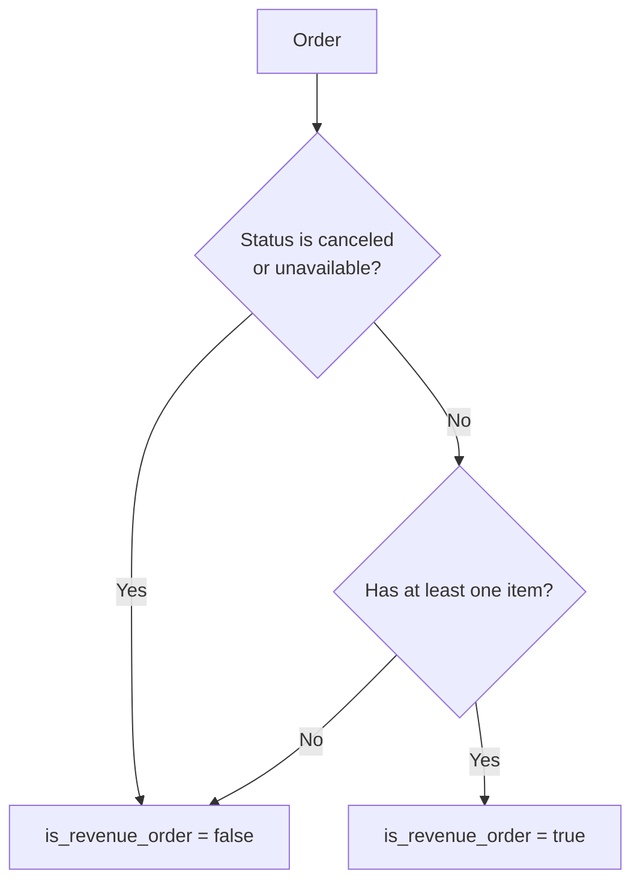
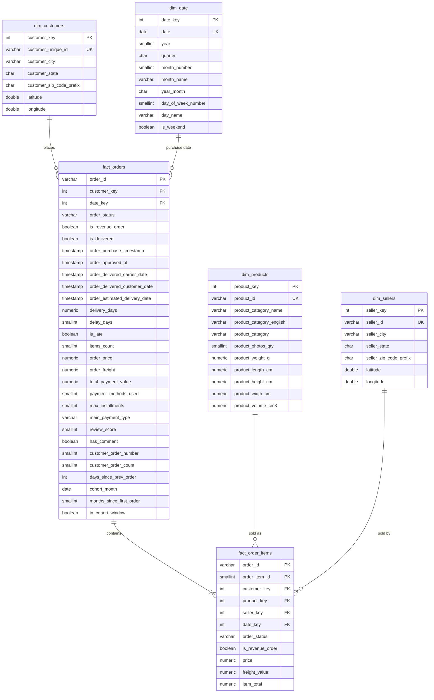

# E-Commerce Analytics Warehouse

**An end-to-end analytics engineering and BI project on the real Olist Brazilian e-commerce dataset: a Python audit and cleaning pipeline, a PostgreSQL star schema, SQL window-function enrichment, and a six-page Power BI dashboard.**

*Internship project by Harshvardhan Singh.*

[](docs/screenshots/01_executive_overview.png)

> **Version 2.** The first version of this repository used generated sample data. It was rebuilt from scratch on the real Olist data, with the payment, review, customer and delivery logic corrected. The original version is preserved under the Git tag `v1-sample-data`.

---

## Table of contents

1. [Project at a glance](#1-project-at-a-glance)
2. [Business context and objectives](#2-business-context-and-objectives)
3. [Executive summary](#3-executive-summary)
4. [Dashboard tour](#4-dashboard-tour)
5. [Key findings](#5-key-findings)
6. [Recommendations](#6-recommendations)
7. [Architecture and workflow](#7-architecture-and-workflow)
8. [Source data](#8-source-data)
9. [Data audit: what was wrong and how it was handled](#9-data-audit-what-was-wrong-and-how-it-was-handled)
10. [Cleaning and transformation approach](#10-cleaning-and-transformation-approach)
11. [Warehouse design and star schema](#11-warehouse-design-and-star-schema)
12. [SQL work](#12-sql-work)
13. [Power BI build](#13-power-bi-build)
14. [Validation and reconciliation](#14-validation-and-reconciliation)
15. [Challenges and lessons learned](#15-challenges-and-lessons-learned)
16. [Limitations and caveats](#16-limitations-and-caveats)
17. [Future work](#17-future-work)
18. [Repository structure](#18-repository-structure)
19. [How to reproduce this project](#19-how-to-reproduce-this-project)
20. [Skills demonstrated](#20-skills-demonstrated)
21. [Glossary](#21-glossary)
22. [Data source, licences and credits](#22-data-source-licences-and-credits)
23. [Author](#23-author)

---

## 1. Project at a glance

| | |
|---|---|
| **Goal** | Turn raw marketplace data into a trusted warehouse and a dashboard that answers sales, product, customer and delivery questions |
| **Dataset** | [Olist Brazilian E-Commerce Public Dataset](https://www.kaggle.com/datasets/olistbr/brazilian-ecommerce): 9 CSV files, 99,441 orders, 112,650 order items, Sep 2016 to Oct 2018 |
| **Pipeline** | Python (pandas) to PostgreSQL 18 to Power BI |
| **Warehouse** | 6 tables in schema `dw`: 2 fact tables and 4 dimensions, with primary keys, foreign keys and 7 indexes |
| **Dashboard** | 6 pages, 5 relationships, about 30 DAX measures, synced slicers, a custom dark-green theme and a 30-icon set |
| **Headline result** | R$13.49M product revenue across 98,199 orders, 93.2% delivered on time, 4.09 average review, and only 3.0% of customers ever reorder |

---

## 2. Business context and objectives

Olist is a Brazilian marketplace that connects small sellers to large online sales channels. The dataset describes real orders placed between September 2016 and October 2018: what was bought, from which seller, how it was paid for, how it was delivered, and how the customer rated it.

The project is framed around questions a marketplace manager would ask:

| Area | Question |
|---|---|
| Sales | How much revenue do we make, how is it trending, and when do customers buy? |
| Products | Which categories drive revenue, and which ones disappoint customers or cost the most to ship? |
| Customers | Where are our customers, and do they come back? |
| Fulfilment | How fast do we deliver, how often are we late, and what does lateness do to reviews? |
| Sellers | How concentrated is our seller base? |

Technical objectives:

1. Audit the source data honestly and document every quality issue.
2. Design a warehouse with clear grains, surrogate keys and enforced relationships.
3. Make the numbers trustworthy: every figure on the dashboard reconciles back to the source.
4. Build a dashboard that a non-technical reader can use in a few minutes.

---

## 3. Executive summary

Jan 2017 to Aug 2018 is used for trend charts, because Sep to Dec 2016 and Sep to Oct 2018 contain very few orders.

| Metric | Value |
|---|---|
| Product revenue | **R$13.49M** (98,199 orders, average order value R$137.42) |
| Freight revenue | R$2.24M, equal to 16.6% of product revenue |
| Customers | 95.0K unique people who bought |
| Average review score | **4.09** out of 5 |
| Delivery | 12.6 days on average (median 10.2), **93.2% on time**, 6.8% late |
| Peak month | Nov 2017 (Black Friday): R$1.00M |
| Payment | Credit card on 75.5% of orders, 51.5% of orders paid in instalments |
| Repeat purchase | Only **3.0%** of customers (2,887) ordered more than once |
| Concentration | Sao Paulo customers bring 38.3% of revenue, and the top 10 categories bring 62.4% |

---

## 4. Dashboard tour

The dashboard has a left rail on every page with the logo, a page navigator and three slicers (year, customer state, product category) that stay in sync across pages. Every page ends with a **key insight banner**, written by a DAX measure so the sentence updates when filters change.

### Page layout

```
+--------+------------------------------------------------------------+
| Logo   |  Page icon  Title                                          |
| Olist  |             Subtitle                                       |
+--------+------------------------------------------------------------+
| Page   |  [ KPI ] [ KPI ] [ KPI ] [ KPI ] [ KPI ] [ KPI ]           |
| navi-  +------------------------------------------------------------+
| gator  |  Main chart or table                                       |
|        +-----------------------------+------------------------------+
| Filters|  Chart                      |  Chart                       |
| Year   +-----------------------------+------------------------------+
| State  |  Key insight banner                                        |
| Categ. |                                                            |
+--------+------------------------------------------------------------+
```

### Navigation map



### Page 1: Executive overview


*Question answered: how is the business doing at a glance?*

- 6 KPI cards: product revenue, orders, average order value, customers, average review, on-time delivery.
- Monthly revenue area chart (Jan 2017 to Aug 2018), revenue share by state (top 5), top 5 categories by revenue.

### Page 2: Sales and revenue trends


*Question answered: when and how do customers buy?*

- 5 KPI cards: product revenue, freight revenue, freight versus product, peak hour, instalment share.
- Orders per month, orders by weekday, payment mix donut, items by price band.

### Page 3: Products and categories


*Question answered: what sells, what customers rate well, and what shipping costs?*

- 4 KPI cards: categories with sales, top 10 share, categories needed for 80% of revenue, average item price.
- A top 8 category table with revenue, average review and freight share, plus a revenue concentration chart.

### Page 4: Customers and retention


*Question answered: where are customers, and do they come back?*

- 4 KPI cards: customers, repeat rate, revenue from repeat customers, median days to a second order.
- Orders by customer state, cohort retention by month since first order, and a customer map.

### Page 5: Orders and fulfilment


*Question answered: how fast do we deliver, and what does lateness cost us?*

- 5 KPI cards: delivered rate, average delivery days, on-time %, late %, cancelled %.
- Average delivery days for all 27 states with a green-to-coral gradient, average review on time versus late, order status mix.

### Page 6: Insights and recommendations


*Question answered: so what should we do?*

- Four findings and four recommendations, each backed by a number from the warehouse, plus a method note that explains how the figures are defined.

### Design system

| Role | Colour |
|---|---|
| Page background | `#0E201B` |
| Left rail | `#0A1814` |
| Cards and charts | `#153229` |
| Accent (lime) | `#95BF47` |
| Titles | `#C8F264` |
| Secondary (mint) | `#3DD6B0` |
| Warning (coral) | `#FF7A59` |
| Text | `#FEFEFE` and `#D2E6DA` |

Typography is Segoe UI and Segoe UI Semibold. The canvas is 1920 x 1080 pixels. Icons are the [Lucide](https://lucide.dev) set, rendered in lime and white (see `docs/icons`).

---

## 5. Key findings

### 5.1 Sales and revenue

- **Revenue grew about eightfold in 2017.** Monthly product revenue rose from R$0.12M in Jan 2017 to R$1.00M in **Nov 2017**, the Black Friday month, with 7.4K orders. After that it plateaued, between R$0.84M and R$0.99M a month throughout 2018.
- **Average order value is R$137.42**, but the typical item is cheaper: the median item price is about R$75, and 64.2% of items sell for R$100 or less. Only 2.8% of items cost over R$500.
- **Freight is a real cost to the customer.** It adds R$2.24M, which is 16.6% of product revenue.
- **Buying has a rhythm.** Orders peak at **16:00** (6.6K orders) and on Mondays (15,978 orders), while Saturdays are about a third lower (10,763).
- **Brazil pays by card and in instalments.** Credit card is the main payment method on 75.5% of orders, then boleto (bank slip) 19.9%, voucher 3.1% and debit card 1.5%. 51.5% of orders are paid in more than one instalment.



### 5.2 Products and categories

- **Revenue is concentrated.** 18 of 73 categories earn 80% of revenue, and the top 10 bring 62.4%. The remaining categories each contribute very little.
- **Top categories:** Health Beauty (R$1.26M), Watches Gifts (R$1.20M), Bed Bath Table (R$1.04M), Sports Leisure (R$0.98M) and Computers Accessories (R$0.90M).
- **Some big categories disappoint customers.** Bed Bath Table (3.97) and Furniture Decor (4.02) rate below the 4.09 average and carry above-average freight (19.7% and 23.7% of product revenue). Watches Gifts, by contrast, ships cheaply (8.4%) and rates 4.07.

| Category | Revenue | Avg review | Freight vs product |
|---|---|---|---|
| Health Beauty | R$1.26M | 4.19 | 14.5% |
| Watches Gifts | R$1.20M | 4.07 | 8.4% |
| Bed Bath Table | R$1.04M | 3.97 | 19.7% |
| Sports Leisure | R$0.98M | 4.18 | 17.1% |
| Computers Accessories | R$0.90M | 4.04 | 16.2% |
| Furniture Decor | R$0.73M | 4.02 | 23.7% |
| Housewares | R$0.63M | 4.16 | 23.2% |
| Cool Stuff | R$0.62M | 4.18 | 13.4% |

### 5.3 Customers and retention

- **The marketplace is acquisition driven.** Only **2,887 of 94,983 customers (3.0%)** ordered more than once, and those repeat customers bring just 5.6% of revenue.
- **Repeat buyers take their time.** The median gap between a first and second order is **28 days**.
- **Early retention is very low.** In the Jan 2017 to Feb 2018 cohorts, only 0.48% of customers order again in the first month, falling to 0.23% by month six.
- **Geography is concentrated.** Sao Paulo state accounts for 41.1K orders and 38.3% of revenue, followed by Rio de Janeiro (12.7K orders) and Minas Gerais (11.5K).
- **Identity matters.** 99,441 customer IDs belong to only 96,096 people, so naive customer counts would overstate the base.

| Months since first order | 1 | 2 | 3 | 4 | 5 | 6 |
|---|---|---|---|---|---|---|
| Share of cohort ordering again | 0.48% | 0.36% | 0.27% | 0.29% | 0.24% | 0.23% |

### 5.4 Delivery and fulfilment

- **Most orders arrive, and mostly on time.** 97.0% of orders were delivered, 93.2% of delivered orders arrived on or before the promised date, and 0.6% were cancelled.
- **Lateness is costly.** Orders delivered late average **2.27 stars**, against **4.29** for on-time orders, a gap of about two stars.
- **Delivery time depends heavily on geography.** Sao Paulo averages 8.8 days, Parana and Minas Gerais 12.0, while the north and north-east wait far longer: Para 23.8, Alagoas 24.5, Amazonas 26.4, Amapa 27.2 and Roraima 29.4 days. The busiest slow states are Bahia (19.3), Pernambuco (18.4) and Ceara (21.3).

### 5.5 Seller concentration

- **3,053 sellers made sales.** The top 10% (305 sellers) earn **67.4%** of revenue.
- **Sellers cluster in Sao Paulo.** Sellers based there earn **64.4%** of revenue, which helps explain why delivery to far-away states is slow.

---

## 6. Recommendations

| # | Recommendation | Evidence |
|---|---|---|
| 1 | **Regional fulfilment.** Test hubs or carrier partnerships for the north and north-east, starting with Bahia, Pernambuco and Ceara. | Delivery takes 18 to 24 days there against 8.8 in Sao Paulo |
| 2 | **Win-back at four weeks.** Time a re-engagement offer near the 28-day median for second orders. | Only 3.0% of customers reorder, and repeat customers bring 5.6% of revenue |
| 3 | **Reset delivery expectations.** Show realistic delivery dates for far-away states and large items. | Late orders lose about two stars (4.29 to 2.27) |
| 4 | **Watch seller concentration.** Track the revenue share of the top sellers and recruit sellers outside Sao Paulo. | Top 10% of sellers earn 67.4%, Sao Paulo sellers 64.4% |

---

## 7. Architecture and workflow



### Project phases

| Phase | What happened |
|---|---|
| 1. Understand | Read the dataset description and map the 9 files to the business process |
| 2. Audit | Profile every table: shapes, types, missing values, duplicates, keys |
| 3. Clean | Fix types, zip codes, categories, payments, reviews and locations |
| 4. Model | Define grains, business rules and surrogate keys, and build 6 tables |
| 5. Load | Create the schema with constraints and indexes, then load from Python |
| 6. Verify | Reconcile counts and revenue in Python and again inside PostgreSQL |
| 7. Enrich | Add customer-sequence and cohort columns with SQL window functions |
| 8. Visualise | Build the Power BI model, measures and six pages |
| 9. Validate and polish | Compare dashboard numbers to independent calculations, then fix every mismatch |
| 10. Publish | Document, screenshot and push to GitHub |

---

## 8. Source data

Nine CSV files, joined by the keys shown below.

| File | Rows | What one row is |
|---|---|---|
| `olist_orders_dataset.csv` | 99,441 | one order, with status and 5 timestamps |
| `olist_order_items_dataset.csv` | 112,650 | one product unit within an order (price, freight) |
| `olist_order_payments_dataset.csv` | 103,886 | one payment on an order (an order can have several) |
| `olist_order_reviews_dataset.csv` | 99,224 | one review (an order can have several) |
| `olist_customers_dataset.csv` | 99,441 | one customer ID (created per order) |
| `olist_products_dataset.csv` | 32,951 | one product |
| `olist_sellers_dataset.csv` | 3,095 | one seller |
| `olist_geolocation_dataset.csv` | 1,000,163 | one coordinate sample for a zip-code prefix |
| `product_category_name_translation.csv` | 71 | Portuguese to English category name |

Date range: 4 Sep 2016 to 17 Oct 2018.



---

## 9. Data audit: what was wrong and how it was handled

Every table was profiled before anything was cleaned. This table lists what was found and the decision taken.

| # | Table | Finding | Evidence | Treatment |
|---|---|---|---|---|
| 1 | orders | All date columns are stored as text | dtype `object` on 5 columns | Converted to datetime |
| 2 | orders | Missing dates are normal, not errors | 2,965 orders without a delivery date match cancelled, unavailable and in-flight statuses | Left empty; delivery metrics use only delivered orders with a delivery date |
| 3 | orders | 8 delivered orders have no delivery date, and 6 cancelled orders have one | Cross-check of status against date | Excluded from delivery metrics |
| 4 | customers | `customer_id` is created per order | 99,441 customer IDs but only **96,096 unique people** | Customer dimension built on `customer_unique_id` |
| 5 | customers, sellers | Zip codes lost their leading zeros | `1151` instead of `01151` | Padded to 5 characters |
| 6 | products | 610 products have no category, name length, description length or photo count | `isnull().sum()` | Labelled `unknown` instead of dropped, because they still sell |
| 7 | products | 2 products have no weight or dimensions | `isnull().sum()` | Left empty, as size is not analysed |
| 8 | products | Column names misspelled (`lenght`) | Column list | Renamed |
| 9 | translation | 2 categories in use have no English name | `pc_gamer`, `portateis_cozinha_e_preparadores_de_alimentos` | Added by hand (73 rows) |
| 10 | order_items | 775 orders have no items | Mostly unavailable (603) and canceled (164) | Kept in `fact_orders`, flagged as not revenue |
| 11 | order_items | No duplicate (order, item) pairs | 0 duplicates | Confirmed the grain of `fact_order_items` |
| 12 | payments | **One order, many payment rows** | 99,440 orders but 103,886 rows; 2,961 orders have 2 or more payments | Collapsed to one row per order before any join, to avoid double-counting |
| 13 | payments | Payments reconcile with item price plus freight | 99.7% of orders match within 2 cents | Item prices are the source of truth for revenue |
| 14 | payments | 3 rows with type `not_defined` and value 0; 1 delivered order with no payment record | `value_counts` | Relabelled `unknown`; left the single order alone |
| 15 | reviews | **One order, many reviews**, and `review_id` is not unique | 543 orders with 2 reviews and 4 with 3; 98,410 unique IDs in 99,224 rows | Kept the latest review per order (98,673 rows) |
| 16 | reviews | Comments are mostly empty | 88% missing titles, 59% missing messages | Kept a yes or no `has_comment` flag only |
| 17 | geolocation | 1M rows for only 19,015 zip codes, with 261,831 exact duplicates | `duplicated().sum()` | Collapsed to one median point per zip |
| 18 | geolocation | 42 points outside Brazil | Latitude up to 45, longitude up to 121 | Removed (19,010 zips left) |
| 19 | all | Sep to Dec 2016 and Sep to Oct 2018 are nearly empty | Monthly order counts | Trend charts use Jan 2017 to Aug 2018 |

---

## 10. Cleaning and transformation approach

All cleaning is in `notebooks/01_data_audit_and_cleaning.ipynb`, written as a readable audit: each table is explored, each issue is proven with a small query, and then it is fixed.



### Business rules decided during modelling



| Rule | Definition |
|---|---|
| **Revenue order** | Not canceled, not unavailable, and has at least one item. 98,199 orders qualify. About R$97K of item prices sit on non-revenue orders, so they are flagged rather than deleted |
| **Product revenue** | Sum of item `price` on revenue orders. Freight is reported separately |
| **Delivery days** | Days from purchase to customer delivery, for delivered orders with a delivery date |
| **Late order** | Delivered on a calendar day after the promised date. Dates are compared without the time of day, because the promised date is always midnight |
| **Customer** | One real person (`customer_unique_id`), located by the zip code of their most recent order |
| **Main payment method** | The payment with the largest value on the order |

---

## 11. Warehouse design and star schema

### Star schema



### Tables and grains

| Table | Type | Grain (one row is...) | Rows |
|---|---|---|---|
| `fact_order_items` | Fact | one product unit sold | 112,650 |
| `fact_orders` | Fact | one order | 99,441 |
| `dim_customers` | Dimension | one real person | 96,096 |
| `dim_products` | Dimension | one product | 32,951 |
| `dim_sellers` | Dimension | one seller | 3,095 |
| `dim_date` | Dimension | one calendar day (2016 to 2018) | 1,096 |

### Why this design

- **Two fact tables, because there are two grains.** Item facts (price, freight) belong to an order line, while order facts (delivery, payment, review) belong to the whole order. Putting order facts on the item table would repeat them on every line and inflate any sum.
- **Surrogate keys.** Whole-number keys replace long text IDs, which makes joins smaller and faster and insulates the model from source-system IDs.
- **Enforced integrity.** Primary keys, unique business keys and foreign keys mean the database itself rejects orphan rows or duplicates.
- **Indexes.** Every foreign key and the order status column are indexed (3 on `fact_orders`, 4 on `fact_order_items`).
- **A dedicated date table** supports month, weekday and weekend analysis and is marked as the date table in Power BI.
- **Customers filter through `fact_orders`.** `fact_order_items` also carries `customer_key` and `date_key` for convenience in SQL, but the Power BI model deliberately relates customers and dates only to `fact_orders`, which avoids ambiguous filter paths.

---

## 12. SQL work

| Script | Purpose |
|---|---|
| `sql/01_create_schema_and_tables.sql` | Creates schema `dw`, the 6 tables with constraints and 7 indexes |
| `sql/02_add_customer_sequence_columns.sql` | Adds customer-sequence and cohort columns using window functions, then runs a verification query |

### Window-function enrichment

Repeat purchase and retention need to know, for each order, which number it is in that customer's history. This is done in SQL once, so every downstream measure stays simple and fast.

```sql
WITH ranked AS (
    SELECT
        order_id,
        order_purchase_timestamp,
        ROW_NUMBER() OVER w                                   AS order_number,
        COUNT(*) OVER (PARTITION BY customer_key)             AS order_count,
        order_purchase_timestamp::date
            - LAG(order_purchase_timestamp::date) OVER w      AS days_since_prev,
        DATE_TRUNC('month',
            MIN(order_purchase_timestamp) OVER (PARTITION BY customer_key))::date AS cohort_month
    FROM dw.fact_orders
    WHERE is_revenue_order
    WINDOW w AS (PARTITION BY customer_key ORDER BY order_purchase_timestamp, order_id)
)
UPDATE dw.fact_orders f
SET customer_order_number = r.order_number, ...
FROM ranked r
WHERE f.order_id = r.order_id;
```

| Column | Meaning |
|---|---|
| `customer_order_number` | 1 for a customer's first order, 2 for the second, and so on |
| `customer_order_count` | Total revenue orders for that customer |
| `days_since_prev_order` | Days between this order and the customer's previous one |
| `cohort_month` | Month of the customer's first order |
| `months_since_first_order` | Whole months between this order and the first |
| `in_cohort_window` | True for cohorts that started Jan 2017 to Feb 2018, which have enough follow-up time for fair retention figures |

Verification inside PostgreSQL: **94,983** first orders, **2,887** repeat customers and a median of **28** days to the second order.

---

## 13. Power BI build

### Data model

Import mode, connected to PostgreSQL. Five relationships, all many-to-one, single direction and active.

| From (many) | To (one) |
|---|---|
| `fact_orders[customer_key]` | `dim_customers[customer_key]` |
| `fact_orders[date_key]` | `dim_date[date_key]` |
| `fact_order_items[order_id]` | `fact_orders[order_id]` |
| `fact_order_items[product_key]` | `dim_products[product_key]` |
| `fact_order_items[seller_key]` | `dim_sellers[seller_key]` |

Filters flow from dimensions to `fact_orders` and on to `fact_order_items`. Power BI auto-detected two extra relationships between the item table and the customer and date dimensions, which created ambiguous paths and switched the correct ones off, so they were deleted.

`dim_date` is marked as the date table. `month_name` is sorted by `month_number`, `day_name` by `day_of_week_number`, `price_band` by `price_band_order` and `month_label` by `year_month`.

### Calculated columns and helper tables

| Name | Table | Purpose |
|---|---|---|
| `in_analysis_window` | `dim_date` | Marks Jan 2017 to Aug 2018, the months with full data |
| `month_label` | `dim_date` | Short month labels such as `Jan 17` |
| `purchase_hour` | `fact_orders` | Hour of purchase |
| `payment_method` | `fact_orders` | Clean payment names without the `unknown` bucket |
| `price_band`, `price_band_order` | `fact_order_items` | Price buckets, sorted cheapest first |
| `Concentration Buckets` | disconnected table | Three labels for the revenue concentration chart |
| `_Measures` | measure table | Holds every measure in one place |

### DAX measure reference

<details>
<summary><b>Revenue, orders and customers</b></summary>

```dax
Product Revenue =
CALCULATE(
    SUM(fact_order_items[price]),
    fact_order_items[is_revenue_order] = TRUE()
)

Orders =
CALCULATE(
    COUNTROWS(fact_orders),
    fact_orders[is_revenue_order] = TRUE()
)

Avg Order Value = DIVIDE([Product Revenue], [Orders])

Customers =
CALCULATE(
    DISTINCTCOUNT(fact_orders[customer_key]),
    fact_orders[is_revenue_order] = TRUE()
)

Avg Review = AVERAGE(fact_orders[review_score])

Freight Revenue =
CALCULATE(
    SUM(fact_order_items[freight_value]),
    fact_order_items[is_revenue_order] = TRUE()
)

Freight vs Product = DIVIDE([Freight Revenue], [Product Revenue])

Installment Share =
DIVIDE(
    CALCULATE([Orders], fact_orders[max_installments] > 1),
    [Orders]
)

Revenue Share =
DIVIDE(
    [Product Revenue],
    CALCULATE([Product Revenue], ALL(dim_customers[customer_state]))
)
```

`Revenue Share` uses `ALL` so that a Top 5 filter on the chart does not shrink the denominator.
</details>

<details>
<summary><b>Delivery and fulfilment</b></summary>

```dax
Measured Deliveries = COUNT(fact_orders[delay_days])

Late Deliveries =
CALCULATE(COUNTROWS(fact_orders), fact_orders[is_late] = TRUE())

On-Time % =
DIVIDE([Measured Deliveries] - [Late Deliveries], [Measured Deliveries])

Late % = DIVIDE([Late Deliveries], [Measured Deliveries])

Avg Delivery Days = AVERAGE(fact_orders[delivery_days])

Delivered Rate =
DIVIDE(
    CALCULATE(COUNTROWS(fact_orders), fact_orders[is_delivered] = TRUE()),
    COUNTROWS(fact_orders)
)

Cancelled % =
DIVIDE(
    CALCULATE(COUNTROWS(fact_orders), fact_orders[order_status] = "canceled"),
    COUNTROWS(fact_orders)
)

Avg Review On Time =
CALCULATE(
    AVERAGE(fact_orders[review_score]),
    FILTER(fact_orders,
        NOT ISBLANK(fact_orders[delivery_days]) && fact_orders[is_late] = FALSE())
)

Avg Review Late =
CALCULATE(AVERAGE(fact_orders[review_score]), fact_orders[is_late] = TRUE())

Order Status Share =
DIVIDE(
    COUNTROWS(fact_orders),
    CALCULATE(COUNTROWS(fact_orders), ALLSELECTED(fact_orders[order_status]))
)
```

`COUNT` is used for `Measured Deliveries` because filtering with `<> BLANK()` would silently drop orders delivered exactly on the promised day (a delay of zero).
</details>

<details>
<summary><b>Products and categories</b></summary>

```dax
Categories With Sales =
CALCULATE(
    DISTINCTCOUNT(dim_products[product_category]),
    fact_order_items[is_revenue_order] = TRUE(),
    dim_products[product_category] <> "Unknown"
)

Top 10 Share =
VAR Cats  = ADDCOLUMNS(ALLSELECTED(dim_products[product_category]), "@Rev", [Product Revenue])
VAR Total = SUMX(Cats, [@Rev])
VAR Top10 = SUMX(TOPN(10, Cats, [@Rev], DESC), [@Rev])
RETURN DIVIDE(Top10, Total)

Categories For 80% =
VAR Cats  = ADDCOLUMNS(ALLSELECTED(dim_products[product_category]), "@Rev", [Product Revenue])
VAR Total = SUMX(Cats, [@Rev])
RETURN
COUNTROWS(
    FILTER(
        Cats,
        VAR r = [@Rev]
        RETURN SUMX(FILTER(Cats, [@Rev] > r), [@Rev]) < 0.8 * Total
    )
)

Category Avg Review =
CALCULATE(
    AVERAGE(fact_orders[review_score]),
    CROSSFILTER(fact_order_items[order_id], fact_orders[order_id], BOTH),
    fact_orders[is_revenue_order] = TRUE()
)

Items Sold =
CALCULATE(COUNTROWS(fact_order_items), fact_order_items[is_revenue_order] = TRUE())

Item Share =
DIVIDE(
    [Items Sold],
    CALCULATE([Items Sold], ALL(fact_order_items[price_band], fact_order_items[price_band_order]))
)
```

A product category normally cannot filter orders, because filters flow downward. `CROSSFILTER ... BOTH` lets the filter travel up to the orders for this one measure.
</details>

<details>
<summary><b>Customers and retention</b></summary>

```dax
Repeat Customers =
CALCULATE(DISTINCTCOUNT(fact_orders[customer_key]), fact_orders[customer_order_count] > 1)

Repeat Rate = DIVIDE([Repeat Customers], [Customers])

Revenue From Repeat =
DIVIDE(
    CALCULATE([Product Revenue], fact_orders[customer_order_count] > 1),
    [Product Revenue]
)

Median Days To 2nd Order =
CALCULATE(MEDIAN(fact_orders[days_since_prev_order]), fact_orders[customer_order_number] = 2)

Retention % =
VAR Num =
    CALCULATE(
        DISTINCTCOUNT(fact_orders[customer_key]),
        fact_orders[in_cohort_window] = TRUE()
    )
VAR Den =
    CALCULATE(
        DISTINCTCOUNT(fact_orders[customer_key]),
        REMOVEFILTERS(fact_orders[months_since_first_order]),
        fact_orders[months_since_first_order] = 0,
        fact_orders[in_cohort_window] = TRUE()
    )
RETURN DIVIDE(Num, Den)
```
</details>

<details>
<summary><b>Dynamic key insight banners</b></summary>

Each page ends with a card driven by a text measure, for example `Key Insight Overview`. It finds the peak month and the top state with `TOPN`, formats the numbers with `FORMAT`, and builds a sentence, so the banner rewrites itself when a slicer changes. Card visuals do not wrap long text, so the sentences are kept short enough to fit on one line.
</details>

### Interaction design

- Three slicers (year, state, category) are synced across pages 1 to 5.
- The cohort retention chart ignores the year slicer on purpose, since cohorts span several years.
- Page 6 is written from the full period, so its slicers are removed.
- Charts that rank (top states, top categories) use Top N filters, and every share measure that sits beside one uses `ALL` to keep a stable denominator.

---

## 14. Validation and reconciliation

Every dashboard number was checked against an independent calculation made directly on the raw data, and again inside PostgreSQL.

| Check | Expected | Result |
|---|---|---|
| Rows loaded: customers, products, sellers, dates | 96,096 / 32,951 / 3,095 / 1,096 | Match |
| Rows loaded: fact_orders, fact_order_items | 99,441 / 112,650 | Match |
| Missing keys in `fact_order_items` | 0 on all four keys | Match |
| Revenue item rows and revenue orders | 112,101 / 98,199 | Match |
| Product revenue (Python, PostgreSQL, Power BI) | R$13,494,400.74 | Match |
| Freight revenue | R$2,241,126.29 | Match |
| Average order value | R$137.42 | Match |
| Order-level and item-level revenue agree | Same total | Match |
| Orders per customer, repeat customers (SQL) | 94,983 / 2,887 | Match |
| Median days to second order (SQL) | 28 | Match |
| On-time delivery, late share | 93.2%, 6.8% | Match |
| Average review on time versus late | 4.29 versus 2.27 | Match |
| State revenue shares | SP 38.3%, RJ 13.4%, MG 11.7%, RS 5.5%, PR 5.0% | Match |
| Price band shares | 34.9%, 29.3%, 23.9%, 9.0%, 2.8% | Match |

---

## 15. Challenges and lessons learned

These are real problems hit during the build, and what each taught.

1. **Joining payments naively would have doubled revenue.** An order can have several payment rows. Payments were collapsed to one row per order first, and item prices were kept as the source of truth after proving the two agree for 99.7% of orders.
2. **Validation caught a rule error.** The first version of `is_revenue_order` gave 98,207 orders, while the item table gave 98,199. The 8 extra were orders with status `created`, `invoiced` or `shipped` but no items. The rule now also requires at least one item.
3. **Auto-detected relationships were wrong.** Power BI created extra relationships and deactivated the correct ones to avoid ambiguity. Reading the relationship list and keeping exactly five fixed it.
4. **A chart sorted by value looked like a decline.** The monthly revenue chart was sorted by revenue instead of by month, which made growth look like a fall. Axis sorting is now set explicitly on every chart.
5. **Top N filters distort shares.** `ALLSELECTED` keeps visual filters, so a Top 5 chart showed SP at 51.8% instead of 38.3%. Switching the denominator to `ALL` fixed it.
6. **Sort-by-column needs the sort column cleared too.** The price band chart showed identical bars until `price_band_order` was included in the `ALL` call.
7. **`<> BLANK()` is not "not blank".** In DAX it treats zero as blank, which would drop orders delivered exactly on time. `COUNT` was used instead.
8. **A leftover filter silently changed a chart.** A copied chart kept an old Top N filter, which skewed the price band shares until it was cleared. Every number was verified against an independent source for this reason.
9. **Product categories cannot filter orders.** Category-level average reviews needed `CROSSFILTER` to move the filter up the relationship.
10. **Cards do not wrap text.** Long dynamic sentences end in `...`, so the insight text had to be shortened.
11. **Some tools ignore exact hex values.** In this Power BI setup `#FFFFFF` and `#0D1F1A` would not apply to text, so `#FEFEFE` and `#0E201B` were used. They look identical.

---

## 16. Limitations and caveats

- **Old, single-marketplace data.** The data covers 2016 to 2018 for one Brazilian marketplace. Findings describe that period and should not be read as current performance.
- **Sparse edge months.** Sep to Dec 2016 and Sep to Oct 2018 are nearly empty, so trend charts use Jan 2017 to Aug 2018.
- **Retention is a lower bound.** Customers who return under a different account would be counted as new, and the observation window is at most two years.
- **No cost data.** The dataset has revenue and freight but no costs, so profit and margin cannot be calculated.
- **Locations are approximate.** Coordinates are the median of a zip-code prefix, and the customer's state is taken from their latest order.
- **Review text is not analysed.** Comments are in Portuguese and mostly empty, so only scores and a has-comment flag are used.
- **Correlation is not causation.** Late orders get low reviews, but the data cannot say how much of that is lateness itself.
- **Public data.** The dataset has been anonymised by Olist, and seller and customer names are not present.

---

## 17. Future work

- Adapt the advanced SQL analysis queries from version 1 to the new warehouse schema.
- Add a customer segmentation page (RFM scoring).
- Add seller scorecards: late rate, review score and revenue per seller.
- Analyse review comments with text processing to find recurring complaints.
- Forecast monthly revenue and order volume.
- Move to DirectQuery or scheduled refresh, and publish to Power BI Service.
- Automate the pipeline end to end with a single script and data-quality tests.

---

## 18. Repository structure

```
ecommerce-data-warehouse
├── README.md
├── requirements.txt
├── .gitignore
├── notebooks/
│   └── 01_data_audit_and_cleaning.ipynb   audit, cleaning, modelling and load
├── sql/
│   ├── 01_create_schema_and_tables.sql    schema, constraints, indexes
│   └── 02_add_customer_sequence_columns.sql   window-function enrichment and checks
├── powerbi/
│   ├── ecommerce_analytics_dashboard.pbix
│   └── ecommerce_theme_green.json
├── docs/
│   ├── screenshots/                        the six dashboard pages
│   └── icons/                              00_logo_olist.png, lime/ and white/ (30 icons each)
└── data/
    ├── raw/                                put the 9 Olist CSV files here (not committed)
    └── processed/                          generated files (not committed)
```

---

## 19. How to reproduce this project

### Prerequisites

- Python 3.10 or later and Jupyter
- PostgreSQL 14 or later (built on 18) and pgAdmin
- Power BI Desktop
- A free Kaggle account to download the dataset

### Steps

1. **Clone the repository.**
   ```
   git clone https://github.com/CryptedBlade/ecommerce-data-warehouse.git
   cd ecommerce-data-warehouse
   ```
2. **Install the Python packages.**
   ```
   pip install -r requirements.txt
   ```
3. **Download the data.** Get the [Olist dataset from Kaggle](https://www.kaggle.com/datasets/olistbr/brazilian-ecommerce), unzip it and put the 9 CSV files in `data/raw/`.
4. **Create the database.** In pgAdmin, create a database named `ecommerce_analytics_dw`, open a Query Tool on it and run `sql/01_create_schema_and_tables.sql`.
5. **Run the notebook.** Start Jupyter, open `notebooks/01_data_audit_and_cleaning.ipynb` and run it from the top. When it reaches the connection cell it asks for your PostgreSQL password with a hidden prompt. The password is never stored in the notebook. The last cells load the six tables and check the counts.
6. **Add the customer-sequence columns.** Run `sql/02_add_customer_sequence_columns.sql`. Re-run it whenever the notebook reloads the tables, because the load clears these columns.
7. **Open the dashboard.** Open `powerbi/ecommerce_analytics_dashboard.pbix`, choose **Transform data → Data source settings**, and point it at your own server and database, then refresh.

---

## 20. Skills demonstrated

| Area | Skills |
|---|---|
| Data profiling and cleaning | Auditing 9 tables, handling duplicates, missing values, types, keys and coordinate outliers with pandas |
| Data modelling | Star schema design, grain definition, surrogate keys, fact and dimension tables, business-rule design |
| SQL and PostgreSQL | DDL, constraints, foreign keys, indexes, CTEs, window functions (`ROW_NUMBER`, `LAG`, `COUNT OVER`, `MIN OVER`), `PERCENTILE_CONT`, verification queries |
| Python | pandas, SQLAlchemy, secure credential entry, bulk loading |
| Power BI and DAX | Model relationships, calculated columns, time and date handling, `CALCULATE`, `ALL`, `ALLSELECTED`, `REMOVEFILTERS`, `CROSSFILTER`, `TOPN`, `ADDCOLUMNS`, variables, dynamic text |
| Dashboard design | Information hierarchy, layout grid, colour system, iconography, consistent KPI cards, slicer sync, interaction control |
| Analytical thinking | Cohort retention, concentration analysis (Pareto), delivery performance, business recommendations |
| Quality and rigour | Reconciling every figure against an independent source, and documenting defects and fixes |
| Communication | Documentation, README, findings written for a business reader |

---

## 21. Glossary

| Term | Meaning |
|---|---|
| **Grain** | What one row of a table represents |
| **Star schema** | A warehouse layout with fact tables in the middle and dimension tables around them |
| **Surrogate key** | A simple whole-number key created by the warehouse, in place of a source ID |
| **Fact table** | A table of measurable events, such as orders or items sold |
| **Dimension table** | A table of descriptive attributes, such as customer, product or date |
| **Cohort** | A group of customers who made their first purchase in the same month |
| **Retention** | The share of a cohort that orders again in a later month |
| **Boleto** | A Brazilian bank-slip payment, paid offline against a printed or digital slip |
| **Instalments** | Splitting one card payment into several monthly payments |
| **Freight** | The shipping fee charged on an item |
| **On time** | Delivered on or before the promised delivery date |
| **Pareto analysis** | Looking at how few items account for most of a total (for example, 18 categories for 80% of revenue) |

---

## 22. Data source, licences and credits

- **Data:** [Brazilian E-Commerce Public Dataset by Olist](https://www.kaggle.com/datasets/olistbr/brazilian-ecommerce), licensed CC BY-NC-SA 4.0. The data was anonymised by Olist. This project is for learning and portfolio use.
- **Icons:** [Lucide](https://lucide.dev), licensed ISC, rendered to PNG in lime and white.
- **Tools:** Python, pandas, SQLAlchemy, PostgreSQL, pgAdmin, Jupyter, Power BI Desktop.

---

## 23. Author

**Harshvardhan Singh**

- GitHub: [CryptedBlade](https://github.com/CryptedBlade)
- LinkedIn: [linkedin.com/in/harshhhhhh](https://www.linkedin.com/in/harshhhhhh)
- Portfolio: [harshhhhhdata.lovable.app](https://harshhhhhdata.lovable.app)

*Feedback and questions are welcome through GitHub issues.*
