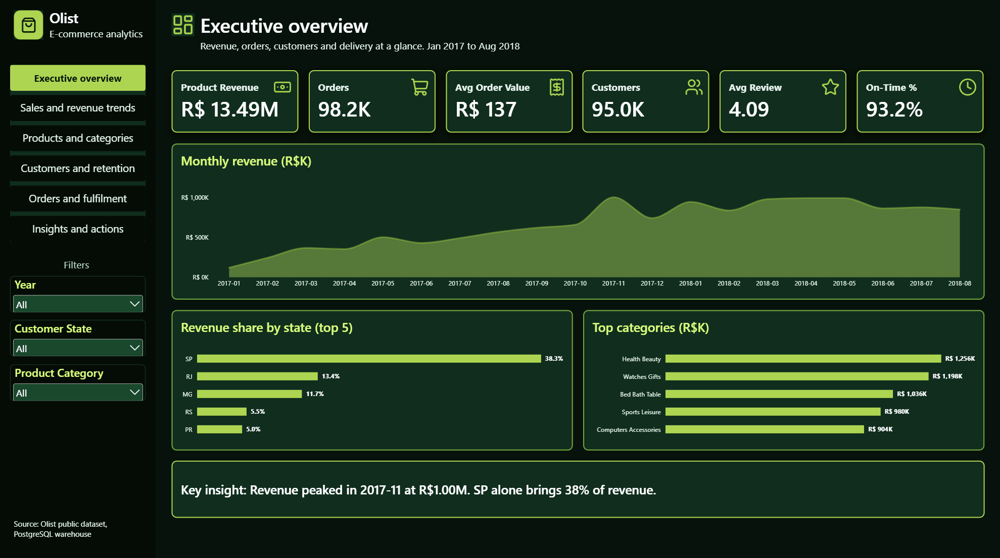
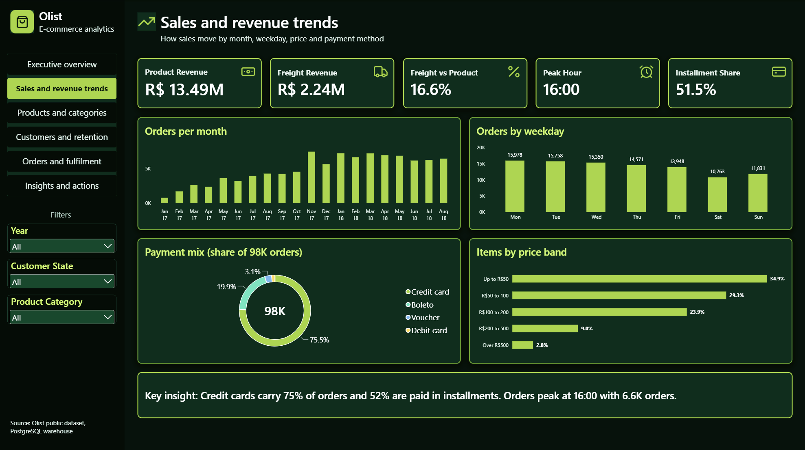
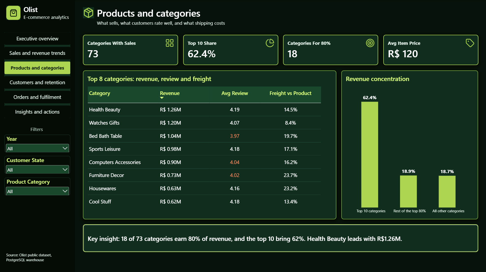
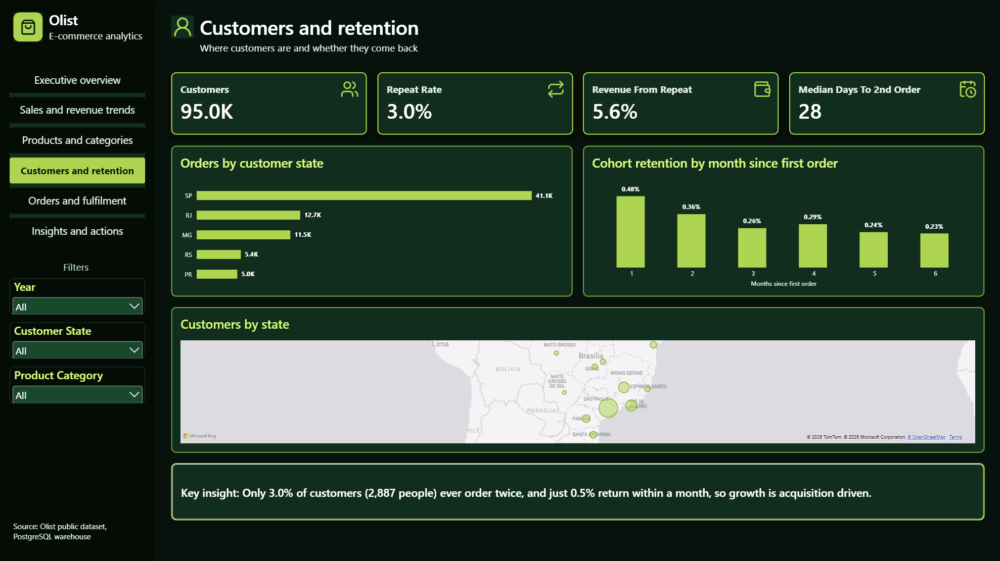
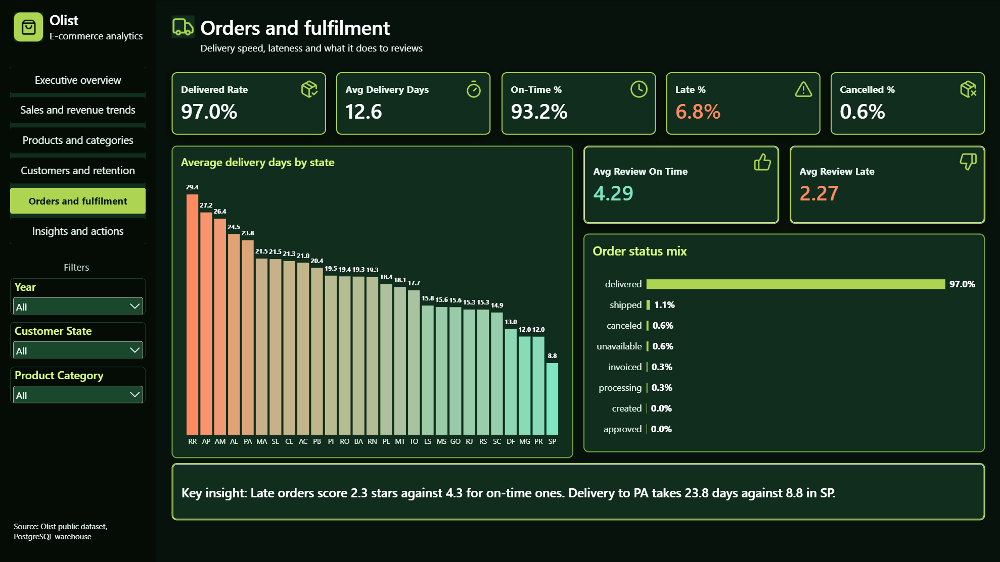
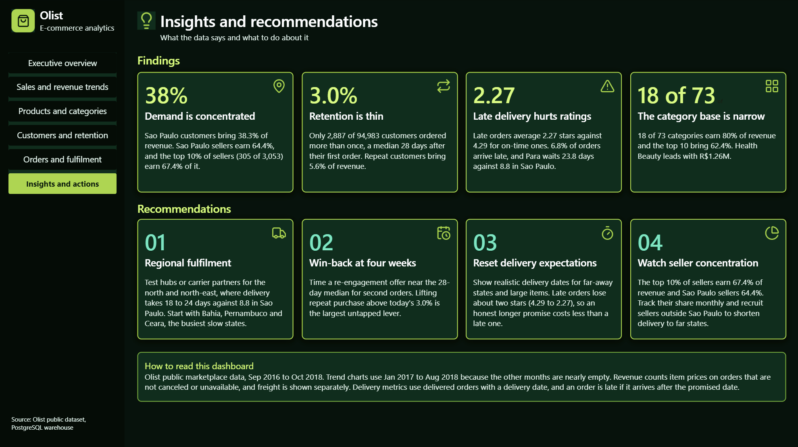
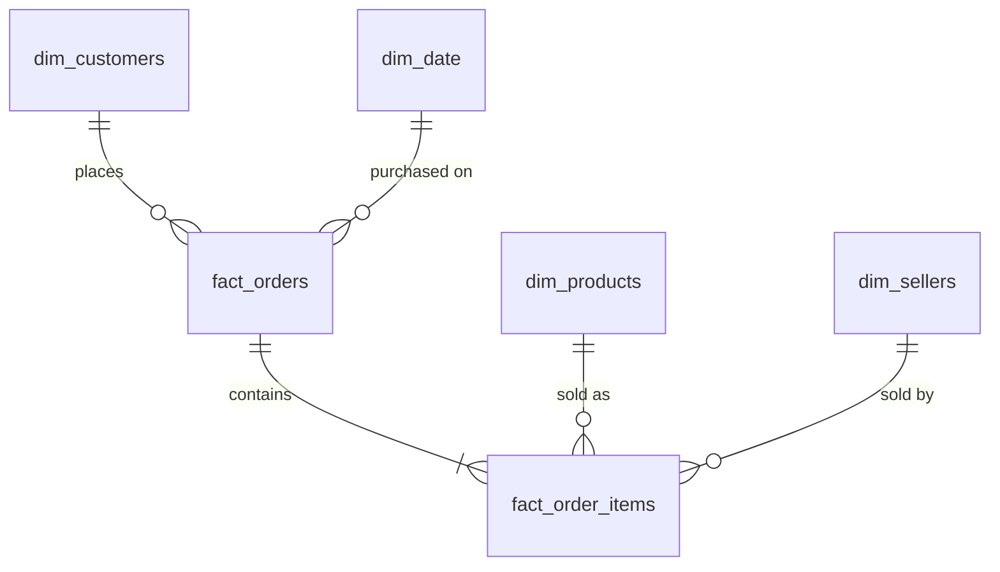

# E-Commerce Analytics Warehouse

End-to-end analytics project on the real **Olist Brazilian e-commerce dataset** (99,441 orders, 2016 to 2018): a Python cleaning pipeline, a **PostgreSQL star schema**, and a **six-page Power BI dashboard** with a dark green theme.

> **Version 2.** The first version of this repository used generated sample data. It has been rebuilt from scratch on the real Olist data, with the payment, review and delivery logic corrected. The old version is kept under the tag `v1-sample-data`.

## Dashboard

| | |
|---|---|
|  |  |
|  |  |
|  |  |

## Headline results

Jan 2017 to Aug 2018 is used for trends, because Sep to Dec 2016 and Sep to Oct 2018 are nearly empty.

| Metric | Value |
|---|---|
| Product revenue | R$13.49M (98,199 orders, average order value R$137.42) |
| Freight revenue | R$2.24M (16.6% of product revenue) |
| Customers | 95.0K unique customers |
| Average review score | 4.09 out of 5 |
| Average delivery time | 12.6 days, 93.2% delivered on time (6.8% late) |
| Peak month | Nov 2017 (Black Friday), R$1.00M |
| Payment method | Credit card on 75.5% of orders, 51.5% paid in installments |

## What the data says

- **Demand is concentrated.** Sao Paulo customers bring 38.3% of revenue. Sao Paulo sellers earn 64.4%, and the top 10% of sellers (305 of 3,053) earn 67.4% of it.
- **Retention is thin.** Only 3.0% of customers (2,887 of 94,983) ordered more than once, a median 28 days after their first order. Repeat customers bring 5.6% of revenue.
- **Late delivery hurts ratings.** Late orders average 2.27 stars against 4.29 for on-time orders. Delivery to Para takes 23.8 days against 8.8 in Sao Paulo.
- **The category base is narrow.** 18 of 73 categories earn 80% of revenue, and the top 10 bring 62.4%.

## Architecture

```
Kaggle CSV files  ->  Python / pandas  ->  PostgreSQL star schema  ->  Power BI
(9 Olist tables)      audit and clean      dw.* tables, SQL          6 pages, DAX measures
```

## Data model



| Table | Grain (one row is...) |
|---|---|
| `fact_order_items` | one product unit sold: price, freight |
| `fact_orders` | one order: status, delivery, payment summary, review, customer sequence |
| `dim_customers` | one real person (`customer_unique_id`) |
| `dim_products` | one product, with English category names |
| `dim_sellers` | one seller |
| `dim_date` | one calendar day |

## Key modelling decisions

- **Revenue rule.** Canceled and unavailable orders stay in the tables but are flagged `is_revenue_order = false`. Orders without items are excluded too.
- **Payments are collapsed to one row per order** before joining, because 3,400 orders were paid in several parts. Joining raw payments would double-count revenue. Payments reconcile with item price plus freight for 99.7% of orders.
- **Reviews are reduced to one per order**, keeping the latest, because some orders have several.
- **Customers are one row per person.** In Olist, `customer_id` is created per order, so 99,441 IDs map to only 96,096 people.
- **Late means delivered after the promised date**, compared by calendar day. Delivery metrics use delivered orders with a delivery date.
- **Locations** come from a zip-code table collapsed to one median point per zip, with 42 coordinates outside Brazil removed. Leading zeros in zip codes are restored.
- **Customer sequence columns** (order number, days since previous order, cohort month) are added in SQL with window functions to support repeat-purchase and retention measures.
- **Two missing category translations** (`pc_gamer` and `portateis_cozinha_e_preparadores_de_alimentos`) are added by hand, and products with no category are labelled `unknown`.

## Repository structure

```
ecommerce-analytics-warehouse
├── notebooks/        01_data_audit_and_cleaning.ipynb  (audit, cleaning, modelling, load)
├── sql/              01_create_schema_and_tables.sql, 02_add_customer_sequence_columns.sql
├── powerbi/          ecommerce_analytics_dashboard.pbix
├── docs/screenshots/ dashboard page images
└── data/             raw and processed folders (data files are not committed)
```

## How to run it

1. Download the [Olist dataset from Kaggle](https://www.kaggle.com/datasets/olistbr/brazilian-ecommerce) and put the 9 CSV files in `data/raw/`.
2. Install the requirements: `pip install -r requirements.txt`.
3. Create a PostgreSQL database named `ecommerce_analytics_dw` and run `sql/01_create_schema_and_tables.sql`.
4. Run `notebooks/01_data_audit_and_cleaning.ipynb` from the top. It asks for your PostgreSQL password when it connects, and loads the six warehouse tables.
5. Run `sql/02_add_customer_sequence_columns.sql`. (Re-run it whenever the notebook reloads the tables.)
6. Open `powerbi/ecommerce_analytics_dashboard.pbix` and point it at your database.

## Tools

Python (pandas, SQLAlchemy), PostgreSQL 18, SQL window functions, Power BI (DAX, star-schema modelling), Jupyter.

## Data source

[Brazilian E-Commerce Public Dataset by Olist](https://www.kaggle.com/datasets/olistbr/brazilian-ecommerce), licensed CC BY-NC-SA 4.0.
